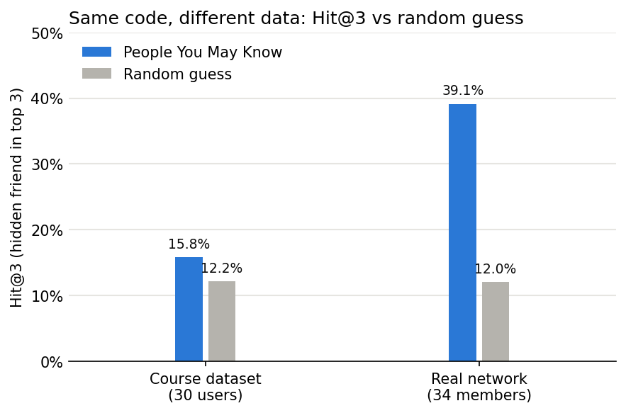

# People You May Know: Friend & Page Recommender

A recommendation engine in plain Python that suggests **people you may know** (ranked by mutual friends) and **pages you might like** (user-based collaborative filtering). It cleans the data first, explains every suggestion, and is evaluated offline on the course dataset and on a real social network.



## Results

Evaluation: hide one real friendship at a time (leave-one-out), ask for the top-k suggestions, and count a hit if the hidden friend comes back. **Hit@k** = share of hidden friends found. The random guess picks k people from everyone the user is not friends with.

| | Course dataset (30 users, 79 friendships) | Real network: Zachary's Karate Club (34 members, 78 friendships) |
|---|---|---|
| Hit@1 | 8.2% (random 4.1%) | 23.1% (random 4.0%) |
| Hit@3 | 15.8% (random 12.2%) | **39.1% (random 12.0%), 3.25x better** |
| Hit@5 | 17.7% (random 20.3%) | 48.7% (random 20.0%) |
| Friend pairs with a mutual friend | 28% (non-friend pairs: 53%) | 86% (non-friend pairs: 55%) |

**Key findings**
- **The same code works on real data but not on the course data.** Mutual-friend ranking assumes that friends of friends become friends. In the real network, 86% of friend pairs share a mutual friend; in the course data only 28% do, fewer than among non-friends (53%). So on the course data it is close to random, and the evaluation shows why.
- **Cleaning fixed real bugs.** It made 8 one-way friendships two-way and caught a blank name, a duplicate friend, a duplicate page id and a reference to a deleted user. The last one made the original course code crash (`KeyError`) or suggest the deleted user.
- **Page suggestions needed a fallback.** The data is sparse (each user likes 1–2 pages), so collaborative filtering alone gave 14 of 30 users nothing. A popularity fallback raised coverage from 16/30 to 30/30 users, and the share of hidden likes recovered in the top 3 from 0% to 21.4% (6 of 28).

## How it works

1. **Clean** (`clean_data`): keep the first page for a duplicate id, drop users with a blank name or no activity, remove duplicate, self and missing friend ids, make friendships two-way, and drop unknown page ids. Every fix is reported, so nothing changes silently.
2. **People You May Know** (`people_you_may_know`): for each friend of the user, look at their friends. Every non-friend found this way is scored by the number of mutual friends. The output shows the name, the score and "because you both know ...".
3. **Pages You Might Like** (`pages_you_might_like`): users who share pages with you add points to the other pages they like (more shared pages = more points). Empty slots are filled with the most popular pages, each labelled with a reason.
4. **Evaluate**: leave-one-out Hit@k for friends (k = 1, 3, 5) and for pages, always compared with a random-guess baseline.

## Project structure

```
people-you-may-know-recommender/
├── people_you_may_know.ipynb   # the whole project, top to bottom
├── data/
│   ├── messy_sample.json       # course data: small messy file used to test cleaning
│   ├── social_network.json     # course data: main dataset, 30 users, 27 pages
│   └── karate_club_edges.csv   # real friendship network (Zachary, 1977)
├── images/
│   └── hit_at_3.png            # chart saved by the notebook
├── requirements.txt
└── README.md
```

## Run it

```
pip install -r requirements.txt
jupyter notebook people_you_may_know.ipynb
```

Then **Kernel → Restart & Run All**. The recommendation logic is plain Python (dicts, sets, loops). pandas is only used to display tables and matplotlib to draw the chart.

## Credits

- **Base project and course data:** the *People You May Know* project from CodeWithHarry's Data Science course. `messy_sample.json` and `social_network.json` are the course files `data.json` and `massive_data.json`, unchanged.
- **My additions:** the data-quality fixes (dangling references, one-way friendships, duplicates), explainable output, the popularity fallback, the offline evaluation with a random baseline, and the comparison on a real network.
- **Real network:** W. W. Zachary (1977), *An Information Flow Model for Conflict and Fission in Small Groups*, Journal of Anthropological Research 33(4), 452–473. The edge list was exported from NetworkX's `karate_club_graph()`, with members numbered 1–34.

## Limitations and next steps

- Both networks are small (30–34 people), so a few hits move the numbers a lot. Next: a larger network such as the SNAP Facebook ego network (~4,000 users).
- Normalise scores (Jaccard, Adamic–Adar) so that very well-connected users don't dominate.
- Combine signals (mutual friends + shared pages) into one score.
